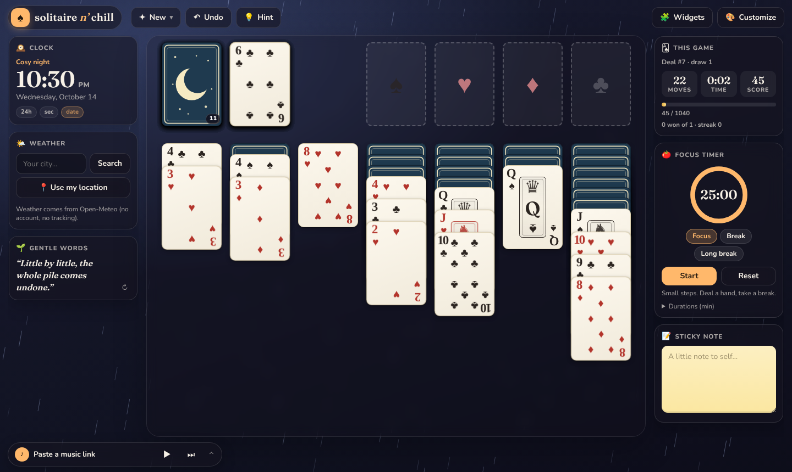

# solitaire n' chill

A cosy, customisable Klondike solitaire that runs entirely in the browser – no build step, no accounts, no tracking.

## What's inside

**Classic Klondike, made to feel good**
- Draw one or draw three, unlimited (or limited) passes through the deck, unlimited undo, hints, and an "I can see the end" **Finish for me** button.
- Click a card and it goes where it obviously belongs; drag to choose for yourself (stacks too). Cards glide, flip and tilt as you carry them.
- "Friendly deals": shuffles are test-solved so you never start a hopeless game. Daily deal, replay-this-deal and a seed shown on every deal.
- Scoring from *The Solitaire Tower of Doom* (max 20 points per card, 1,040 per game) – or switch on **Zen mode** and hide every number.
- Your game, undo history, stats and settings are saved in your browser.

**Music – paste a link and play**
Paste a link into the player (or just paste anywhere on the page) from **YouTube / YouTube Music, Spotify, SoundCloud, Apple Music, Deezer, Mixcloud, Vimeo, Twitch**, or a direct **audio file / internet-radio stream** URL. Keep a little list, repeat, set the volume. Music keeps playing while the panel is closed.

**Make it yours**
- 8 one-tap *vibes*, 11 backgrounds + your own colours or picture (URL or file), darken / blur / film grain.
- Atmosphere: rain, snow, drifting petals, fireflies, stars – or let the real weather decide.
- 8 card-back designs with custom colours, or your own picture; 5 card faces, four-colour suits, card size, table mat.
- Soft built-in ambience: rain, wind, fireplace.

**Widgets** (left / right rails, or a drawer on small screens; arrange, hide and add them)
Clock · Weather (Open-Meteo, no key) · **News** · This game · Focus timer (pomodoro) · Sticky note · Gentle words · Ambience mixer.

**News widget** (off by default – add it from *Widgets*): pick a region from ~50 Google News editions (or "my region"), combine subjects (Top stories, World, National, Local for any town, Business, Tech, Science, Health, Sports, Culture), add keywords, or add your own RSS/Atom feed. Headlines open in a new tab.

**Optional cloud sync:** sign in with Google to save your look, music list, note and statistics to your own account and carry them between devices (stats are merged across devices, so no game is lost). Off by default – see [docs/FIREBASE_SETUP.md](docs/FIREBASE_SETUP.md).

**Keys:** `Space` draw · `U` / `Ctrl+Z` undo · `H` hint · `F` finish · `N` new deal · `M` music · `Esc` close / deselect

## Publish with GitHub Pages

1. Push this repo, then open **Settings → Pages**.
2. Under **Build and deployment**, choose **Deploy from a branch**, pick your default branch and the `/ (root)` folder, and save.
3. Your game appears at `https://<user>.github.io/solitaire-n-chill/`.

Everything is static files (`index.html`, `css/`, `js/`, `assets/`) and uses relative paths, so it works from a project subpath. Use it over **http(s)** – embeds such as YouTube refuse to play from a `file://` page. To try it locally: `python3 -m http.server` and open <http://localhost:8000>.

## Notes on the music player

- Services control their own playback. YouTube, SoundCloud and plain audio get play / pause / volume buttons; Spotify, Apple Music, Deezer, Mixcloud, Vimeo and Twitch show their own player (browsers don't let a page start those automatically – press play inside the embed). Spotify only plays full tracks if you're logged in to Spotify in that browser.
- Some videos disallow embedding; the player will tell you and you can pick another.
- Radio streams must be `https://` to play on an `https://` page.
- Titles are looked up through each service's public oEmbed endpoint when possible, and fall back to a plain label.

## Notes on the news widget

Google News RSS can't be read directly from a web page (no CORS), so feeds are fetched through public relay services – `rss2json`, then `allorigins`, then `corsproxy.io` – and the one that last worked is tried first. Those relays can see the region and subjects you choose; nothing else is sent, and there is no account or key. They are free services and can be rate-limited or go down, in which case the widget shows the last cached headlines (15-minute cache) or a retry button.

## How it's built

Plain HTML/CSS/JS (no dependencies, no bundler).

| File | Role |
| --- | --- |
| `js/klondike.js` | Pure rules engine – deal, legal moves, scoring, hints, auto-finish, the friendly-deal solver. Ported from the Tower of Doom web build and made immutable. |
| `js/board.js` | Renders a state with one persistent element per card; pointer-event drag & drop, staggered glide animations, flips. |
| `js/game.js` | Game controller: click logic, undo, timer, persistence, stats. |
| `js/music.js` | Link parsing + YouTube / SoundCloud / audio / embed engines. |
| `js/cloud.js` | Optional Google sign-in + Firestore sync (per-section newest-wins, merged statistics); `firebase/` holds the security rules. |
| `js/news.js` | News widget: Google News editions / topics / keywords / custom feeds through CORS relays. |
| `js/widgets.js`, `js/customize.js`, `js/themes.js`, `js/settings.js` | Widgets, the customise dialog, look catalogue, saved settings. |
| `js/fx.js`, `js/audio.js` | Atmosphere particles + win cascade; card sounds, chimes, ambience synthesis. |

Rules tests: `node tests/rules.test.js`. Cloud-sync tests (two simulated devices against a fake backend; needs `npm i playwright`): `node tests/cloud.sync.test.js`.

### Credits
Gameplay mechanics and the card-sound samples come from *The Solitaire Tower of Doom* (same author). Fonts: Nunito and Fraunces via Google Fonts (optional – falls back to system fonts). Weather: [Open-Meteo](https://open-meteo.com/).
